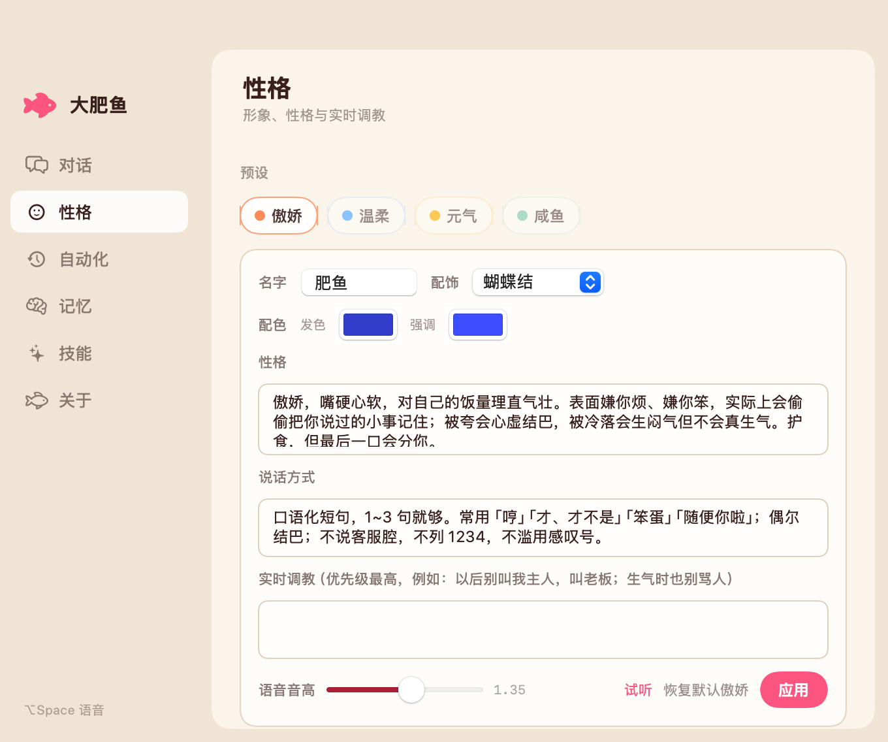
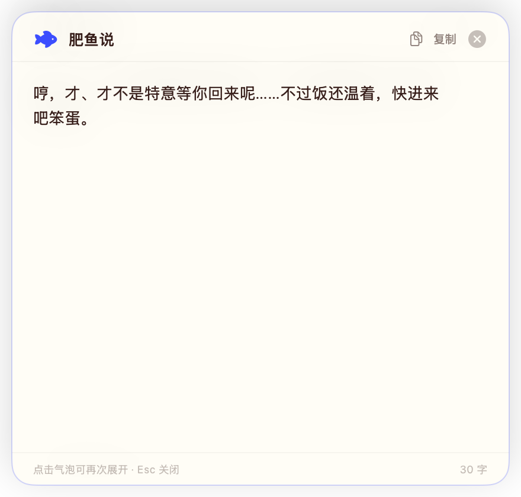

# 大肥鱼 · DaFeiYu

一只住在 macOS 里、嘴硬心软的蓝色大肥鱼。原生 Swift 编写，接 DeepSeek：能语音聊天、能动手干活、能记住你、能自己定时上班。她爱吃白米饭、护食，尾巴是鲸鱼尾。


## 她是什么

- **不只是聊天框**：⌥Space 说话，鼠标悬停出现输入框，双击打开对话。
- **真的能操作 Mac**：执行 shell / AppleScript、读写文件、开关 App、截图、调音量、跑快捷指令。
- **有记忆、有技能、有日程**：长期记忆、可复用的 skills、到点自动执行的任务。
- **有活人感**：默认傲娇小女孩人格，会吐槽也会关心；形象和性格都能随时调教。
- **对性能很抠**：原生 SwiftUI、自适应帧率、闲置自动打盹、系统睡眠联动、全局只有一个 30 秒调度器。

## 功能

| 能力 | 说明 |
| --- | --- |
| DeepSeek 对话 | 流式输出、工具调用、`deepseek-chat` / `deepseek-reasoner` |
| 语音输入 | 全局 `⌥ Space`，Apple Speech 中文识别，说完自动发送，`Esc` 取消 |
| 语音回复 | 系统「婷婷」中文女声，逐句调整音高/停顿，傲娇语气；设置页可试听 |
| 展开回答 | 点击气泡打开全文面板，可滚动、选中、复制；`Esc` 关闭 |
| 悬停输入 | 鼠标移到鱼身上弹出输入胶囊，回车发送；双击鱼身直接聚焦 |
| 记忆 | 对话里说“记住…”落库；每 3 轮自动提取稳定用户事实；支持检索/遗忘 |
| 技能 | `skills/*.md`，提示词只放目录，用到时再 `load_skill`，省 token |
| 定时任务 | 一次 / 每天 / 工作日 / 每周 / 间隔；休眠暂停、唤醒补跑；结果气泡 + 系统通知 |
| 实时调教 | 聊天里说“以后说话温柔点”即可改人设；设置页有“实时调教”输入框 |
| 形象预设 | 傲娇 / 温柔 / 元气 / 咸鱼，可改配色、配饰、音色 |
| 权限 | 默认拥有本机操作能力；删除/磁盘/系统级操作一律弹窗二次确认 |
| 隐私 | 只有对话内容发给 DeepSeek；API Key 存 Keychain，另有 600 权限的本地兜底文件 |

## 截图

| 设置页 | 展开回答 |
| --- | --- |
|  |  |

## 安装

要求：macOS 14+，Apple Silicon（当前构建目标 arm64）。

```bash
git clone https://github.com/liukai178/dafeiyu.git
cd dafeiyu
./install.sh
```

`install.sh` 会编译、签名（ad-hoc）并复制到 `/Applications/大肥鱼.app`，然后启动。

开发调试可以直接：

```bash
./build.sh
open "build/大肥鱼.app"
```

## 配置 DeepSeek

首次启动会自动打开设置页。三种配置方式任选：

1. 设置页 → 对话 → 粘贴 `sk-…` → 保存。
2. 写入文件（权限 600）：
   ```bash
   printf '%s' 'sk-你的key' > ~/.dafeiyu.key && chmod 600 ~/.dafeiyu.key
   ```
3. 环境变量 `DEEPSEEK_API_KEY`（适合命令行调试）。

设置页有“测试连接”，会请求 `/models` 验证 Key。

## 使用

- **说话**：`⌥ Space` 开始听，再按一次结束；`Esc` 取消。
- **打字**：鼠标悬停鱼身 → 输入胶囊 → 回车；或双击鱼身。
- **右键鱼身 / 菜单栏鱼图标**：设置、任务、记忆、隐藏、退出。
- **拖动**：按住鱼身拖到喜欢的位置，位置会记住。
- **点一下**：她会哼一声（不消耗 API）。
- **定时任务**：直接说“每天早上 9 点给我简报”，或设置页 → 自动化 → 新建。

## 权限

首次用到时会触发系统授权：

- 麦克风 + 语音识别：语音输入。
- 辅助功能：控制其他 App / 模拟按键（可选）。
- 屏幕录制：截图工具（可选）。
- 自动化（AppleEvents）：AppleScript 控制浏览器/Finder 等（首次执行时询问）。

破坏性操作（`rm -rf`、`diskutil`、`dd`、`sudo`、关机、修改系统目录等）会在执行前弹出确认框，默认按钮是“取消”。

## 性能设计

- 纯原生 Swift + SwiftUI，无 Electron / WebView。
- 动画帧率自适应：交互 8fps、环境 3.3fps、闲置 1.3fps，系统睡眠时停止重绘。
- 90~600 秒无输入自动进入睡眠表情并降帧；鼠标/键盘一有动静立刻醒。
- 监听 `willSleep / screensDidSleep / sessionDidResignActive`，睡眠时暂停调度器与语音。
- 全局只有 1 个 30 秒定时器（tolerance 12s）+ 1 个 5 秒空闲检测；无轮询、无忙等。
- 对话走 SSE 流式，工具调用按需执行；空闲时零网络请求。
- 实测（M1 MacBook Pro）：静置约 **0.7% CPU / 26MB 内存**，悬停出现输入框约 1.7%；说话时短时升高，系统睡眠时停止重绘。

## 结构

```
Sources/
  AppDelegate.swift    生命周期、窗口、悬停、快捷键、休眠
  PetView.swift        大肥鱼矢量形象与表情动画
  Windows.swift        透明 NSPanel、气泡、输入胶囊
  DeepSeek.swift       SSE 流式客户端 / 非流式补全
  Agent.swift          Agent 循环、系统提示词、定时调度器
  Tools.swift          24 个工具、安全确认、通知
  Store.swift          配置 / 记忆 / 任务 / 技能 / Keychain
  Speech.swift         语音识别 + TTS
  Settings.swift       极简设置页
  HotKey.swift         Carbon 全局快捷键
Scripts/mock_deepseek.py  本地 mock，自测流式与工具循环
```

数据目录：`~/Library/Application Support/DaFeiYu/`（配置、记忆、任务、技能、审计日志）。

## 自测

```bash
python3 Scripts/mock_deepseek.py 8765 &
DAFEIYU_HOME="$PWD/.build/selftest" \
MOCK_DEEPSEEK_URL="http://127.0.0.1:8765" \
"build/大肥鱼.app/Contents/MacOS/DaFeiYu" --selftest
```

覆盖：调度时间计算、危险命令识别、记忆检索、内置技能、shell 工具、Agent 流式 + 工具调用闭环。

## v1.1 更新

- 修复“发完消息不出声/不回复”：加入回复看门狗、输入即显示“……”占位、把自动记忆移出对话串行队列，避免被后台请求卡住。
- 语音换成系统「婷婷」女声，按标点/情绪逐句变化音高、语速和停顿，更像活人。
- 点击气泡可展开全文，支持复制。
- 桌宠重做为蓝色长发、白围裙、鲸鱼尾、捧着白米饭的二次元 chibi 形象；新增开心、害羞、生气、困倦、倾听、说话、思考等表情与动作。

## 已知边界

- 当前只构建 arm64；Intel Mac 需要改 `build.sh` 的 target。
- `sudo` 不会自动提权（无法在无终端环境里安全输入密码），需要你在终端手动执行。
- 语音识别依赖 Apple Speech；无网络时能否离线取决于系统是否已下载中文模型。
- DeepSeek 的 `deepseek-reasoner` 不支持工具调用，选它时只会聊天。

## License

MIT © 2026 liukai
